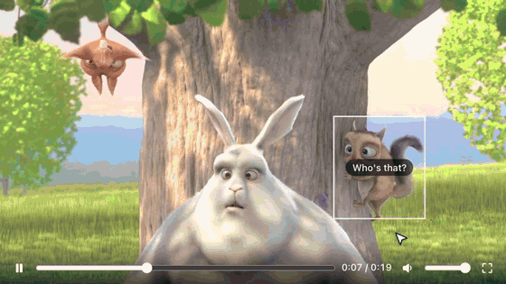

# IVKit

[](https://www.npmjs.com/package/@ivkit/player)
[](https://www.npmjs.com/package/@ivkit/core)
[](https://github.com/Daniel-Glz/ivkit/actions/workflows/ci.yml)
[](LICENSE)

**Turn any video into an interactive one.** Viewers answer questions, choose where the story goes and click animated hotspots, all with a single `<ivkit-player>` tag. No dependencies, under 8 KiB gzip.

<p align="center">
  <a href="https://daniel-glz.github.io/ivkit/examples/">
    
  </a>
  <br>
  <a href="https://daniel-glz.github.io/ivkit/examples/"><b>Try the live examples →</b></a>
</p>

## Two ways to use it

IVKit works with its ready-made player or without it. Both read the same [story format](https://daniel-glz.github.io/ivkit/reference/story-format), so a story written for one plays in the other.

| Package | What you get | Use it when |
| --- | --- | --- |
| [`@ivkit/player`](packages/player) | The `<ivkit-player>` Web Component: videos, questions, hotspots, controls, fullscreen and theming. | You want a player that works out of the box, in plain HTML or any framework. |
| [`@ivkit/core`](packages/core) | The DOM-free engine, media controller and validator the player is built on. | You want your own interface: React or Vue components, a canvas, a game engine. |

`@ivkit/player` includes `@ivkit/core`, so install only one of them.

## With the player

```sh
npm install @ivkit/player
```

```html
<ivkit-player id="player" controls></ivkit-player>

<script type="module">
  import "@ivkit/player";

  document.getElementById("player").story = {
    version: "0.1",
    start: "intro",
    scenes: { intro: { src: "/videos/intro.mp4" } },
  };
</script>
```

Or load it from a CDN, with no build step:

```html
<script type="module" src="https://cdn.jsdelivr.net/npm/@ivkit/player@0.1/dist/ivkit-player.min.js"></script>
```

## Without the player

```sh
npm install @ivkit/core
```

The engine tells you what to show based on playback time, and you draw it however you like:

```ts
import { StoryEngine } from "@ivkit/core";

const engine = new StoryEngine(story);

engine.on("scene", ({ scene }) => {
  video.src = scene.src;
  video.play();
});
engine.on("interaction", ({ question }) => {
  video.pause();
  showQuestion(question); // calls engine.answer(choice.id) on click
});
engine.on("hotspots", ({ hotspots }) => renderHotspots(hotspots));

video.addEventListener("timeupdate", () => engine.update(video.currentTime));
video.addEventListener("ended", () => engine.mediaEnded());

engine.start();
```

Add `MediaController` to preload the next scene and change scenes without a black frame. See [Custom players with core](https://daniel-glz.github.io/ivkit/guide/core) and a [player built in Vue](https://daniel-glz.github.io/ivkit/examples/core-player).

## Documentation

[**Read the documentation →**](https://daniel-glz.github.io/ivkit/)

- [Getting started](https://daniel-glz.github.io/ivkit/guide/getting-started)
- [Custom players with core](https://daniel-glz.github.io/ivkit/guide/core), without `<ivkit-player>`
- [Writing stories](https://daniel-glz.github.io/ivkit/guide/stories)
- [Hotspots](https://daniel-glz.github.io/ivkit/guide/hotspots)
- [Styling the player](https://daniel-glz.github.io/ivkit/guide/styling)
- [Live examples](https://daniel-glz.github.io/ivkit/examples/): branching, quizzes, hotspots, tracking, theming, custom players and validation
- [API reference](https://daniel-glz.github.io/ivkit/reference/story-format)
- [Changelog](CHANGELOG.md)

## Development

See [CONTRIBUTING.md](CONTRIBUTING.md) for setup, commands and size budgets.

## License

[MIT](LICENSE) © Alexis Gonzalez
