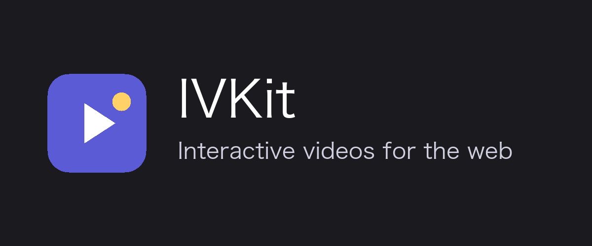

<p align="center">
  <a href="https://daniel-glz.github.io/ivkit/">
    
  </a>
</p>

<p align="center">
  <a href="https://www.npmjs.com/package/@ivkit/player"></a>
  <a href="https://www.npmjs.com/package/@ivkit/react"></a>
  <a href="https://www.npmjs.com/package/@ivkit/core"></a>
  <a href="https://github.com/Daniel-Glz/ivkit/actions/workflows/ci.yml"></a>
  <a href="LICENSE"></a>
</p>

# IVKit

**Turn any video into an interactive one.** Viewers answer questions, choose where the story goes and click animated hotspots, all with a single `<ivkit-player>` tag. No dependencies, under 9.5 KiB gzip.

## Two ways to use it

IVKit works with its ready-made player or without it. Both read the same [story format](https://daniel-glz.github.io/ivkit/reference/story-format), so a story written for one plays in the other.

| Package | What you get | Use it when |
| --- | --- | --- |
| [`@ivkit/player`](packages/player) | The `<ivkit-player>` Web Component: videos, questions, hotspots, controls, fullscreen and theming. | You want a player that works out of the box, in plain HTML or any framework. |
| [`@ivkit/react`](packages/react) | A React component around the player, with typed props and event callbacks, for React 18 and 19. | You use the player in React. |
| [`@ivkit/core`](packages/core) | The DOM-free engine, media controller and validator the player is built on. | You want your own interface: React or Vue components, a canvas, a game engine. |

`@ivkit/player` includes the engine from `@ivkit/core`, so you don't need both. To import story types or `validateStory` next to the player, add `@ivkit/core` at the same version.

## Getting started

### With the player

This page plays a video that stops at second 4 and asks where to go, using the example videos of the documentation. It loads the player from a CDN, so it needs no build step:

```html
<script type="module" src="https://cdn.jsdelivr.net/npm/@ivkit/player@0.3/dist/ivkit-player.min.js"></script>

<ivkit-player id="player" controls></ivkit-player>

<script type="module">
  const videos = "https://daniel-glz.github.io/ivkit/examples/videos";

  document.getElementById("player").story = {
    version: "0.1",
    start: "intro",
    scenes: {
      intro: {
        src: `${videos}/adventure-intro.mp4`,
        events: [
          {
            type: "question",
            id: "path",
            at: 4,
            text: "Where do you want to go?",
            options: [
              { id: "forest", label: "Into the forest", goto: "forest" },
              { id: "city", label: "To the city", goto: "city" },
            ],
          },
        ],
      },
      forest: { src: `${videos}/adventure-forest.mp4` },
      city: { src: `${videos}/adventure-city.mp4` },
    },
  };
</script>
```

With a bundler, install the package and import it once instead of the CDN script:

```sh
npm install @ivkit/player
```

```ts
import "@ivkit/player";
```

### Without the player

```sh
npm install @ivkit/core
```

The engine tells you what to show based on playback time, and you draw it however you like:

```ts
import { StoryEngine } from "@ivkit/core";

const engine = new StoryEngine(story);

engine.on("scene", ({ scene, time }) => {
  video.src = scene.src;
  video.currentTime = time;
  video.play();
});
engine.on("interaction", ({ question }) => {
  video.pause();
  showQuestion(question); // calls engine.answer(choice.id) on click
});
engine.on("resume", ({ time }) => {
  video.currentTime = time;
  video.play();
});
engine.on("hotspots", ({ hotspots }) => renderHotspots(hotspots));

video.addEventListener("timeupdate", () => engine.update(video.currentTime));
video.addEventListener("ended", () => engine.mediaEnded());

engine.start();
```

Add `MediaController` to preload the next scene and change scenes without a black frame. See [Custom players with core](https://daniel-glz.github.io/ivkit/guide/core) and a [player built in Vue](https://daniel-glz.github.io/ivkit/examples/core-player).

## Examples

[**Try the live examples →**](https://daniel-glz.github.io/ivkit/examples/)

- [Branching story](https://daniel-glz.github.io/ivkit/examples/branching): a question branches the story into one of two scenes
- [Quiz with retries](https://daniel-glz.github.io/ivkit/examples/quiz): loops back to the question until it's answered right
- [Hotspot shapes](https://daniel-glz.github.io/ivkit/examples/hotspot-shapes): rectangle, ellipse and polygon hotspots
- [Tracking a moving object](https://daniel-glz.github.io/ivkit/examples/tracking): a hotspot that follows an object with keyframes
- [Custom hotspot content](https://daniel-glz.github.io/ivkit/examples/custom-hotspots): custom variants and badges with `renderHotspot`
- [Custom theme](https://daniel-glz.github.io/ivkit/examples/theming): restyling the player with custom properties, `::part()` and slots
- [Player built with core](https://daniel-glz.github.io/ivkit/examples/core-player): a Vue player on `@ivkit/core`
- [Validation playground](https://daniel-glz.github.io/ivkit/examples/validation): edit a story and see `validateStory` errors as you type

Showcases on real footage:

- [Lesson: a rocket launch](https://daniel-glz.github.io/ivkit/examples/rocket-launch): hotspots on the Artemis I rocket and a scored quiz
- [Following traffic](https://daniel-glz.github.io/ivkit/examples/traffic): hotspots that follow six cars through a roundabout
- [Stories player](https://daniel-glz.github.io/ivkit/examples/stories-player): a vertical, stories-style player built on `@ivkit/core`

## Documentation

[**Read the documentation →**](https://daniel-glz.github.io/ivkit/)

- [Getting started](https://daniel-glz.github.io/ivkit/guide/getting-started)
- [Custom players with core](https://daniel-glz.github.io/ivkit/guide/core), without `<ivkit-player>`
- [Writing stories](https://daniel-glz.github.io/ivkit/guide/stories)
- [Hotspots](https://daniel-glz.github.io/ivkit/guide/hotspots)
- [Styling the player](https://daniel-glz.github.io/ivkit/guide/styling)
- [API reference](https://daniel-glz.github.io/ivkit/reference/story-format)
- [Changelog](CHANGELOG.md)

## Development

See [CONTRIBUTING.md](CONTRIBUTING.md) for setup, commands and size budgets.

## License

[Apache-2.0](LICENSE) © Alexis Gonzalez
